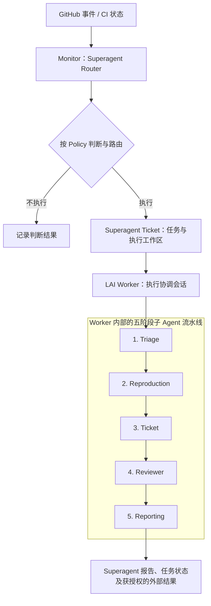

# LAI Trial

LAI 是一个基于 **DeepSeek Harness（DSH）** 二次开发的 Agent 应用：由 **Superagent 负责监控、判断和任务管理**，由 **LAI Worker 调用五个专业子 Agent**，按流水线完成分析、复现、工单整理、审核和报告。

项目面向 CI / GitHub 驱动的工程任务，希望把分散的失败日志、问题讨论和代码变更转化为有执行过程、有证据、有结果的任务记录。

## 项目需求与设计

最初的需求参考六个业务角色的 CI 验证流程：**Monitor、Triage、Reproduction、Ticket、Reviewer、Reporting**。当前实现结合了 Superagent，并调整了它们的运行方式：

- **Monitor 就是 Superagent Router**，负责接收事件、判断任务是否应当执行，以及任务路由和后续讨论。
- Router 决定执行后，通过 Superagent 创建任务及其 **Worker 会话和工作区**。
- Worker 是执行协调者，使用 LAI 的 `iqe-orchestrator` 预设，依次调用五个专业子 Agent。
- 五个子 Agent 是 DSH 原生的父子 Agent，调用记录、执行过程和结果可以在 lai-web 和原版 DSH 中查看。

这里的“六个 Agent”指六类业务角色。实际运行结构还包含一个 Worker 协调会话；Monitor / Router 和 Worker 是通过任务关联的独立会话，五个专业 Agent 才是 Worker 的子 Agent。



### 角色分工

| 业务角色 | 当前实现 | 主要职责 |
| --- | --- | --- |
| Monitor | Superagent Router | 接收来源事件、执行准入判断、关联任务、调度 Worker、处理后续消息 |
| Triage | `iqe-triage` / `triage` | 收集证据、分析失败原因、区分已知事实和待验证假设 |
| Reproduction | `iqe-reproduction` / `reproduce` | 受控复现和验证；对明确授权的修复任务实施必要修改 |
| Ticket | `iqe-ticket` / `ticket` | 整理问题描述、根因、复现步骤和证据，形成工单草稿或变更说明 |
| Reviewer | `iqe-reviewer` / `review` | 独立检查分析、复现和修改结果，给出审核意见 |
| Reporting | `iqe-reporting` / `reporter` | 汇总结果、证据、审核结论和未解决问题 |

**执行顺序固定为 `triage → reproduce → ticket → review → reporter`。** 每一步必须等待当前子 Agent 真实完成，才能进入下一步。执行约束会检查原生子会话历史，并阻止重复、越序及同时启动多个阶段；子 Agent 失败或取消后，不再启动后续阶段。只有五个阶段全部完成，Worker 才能提交 `ready` 报告。

Superagent 的 **Ticket 是任务管理实体**，LAI 的 **Ticket Agent 是其中一个执行阶段**，两者承担不同职责。

### Superagent 与 LAI 的边界

| 部分 | 负责的能力 |
| --- | --- |
| DSH | 模型接入、会话持久化、工具、原生子 Agent、权限及插件运行环境 |
| Superagent | Sources、Policy、Router、任务状态、Worker 生命周期、调度、重试和来源回复 |
| LAI Agents | Worker 协调预设、五个专业角色、可配置 Prompt、串行执行约束 |
| lai-web | 统一的任务、会话、执行过程、配置和结果查看界面 |

原有的 LAI 独立触发层和模拟入口已移除，事件接入与任务生命周期统一由 Superagent 管理。当前架构不依赖 MQ、外部消息 Broker 或共享知识库；本地 SQLite 和持久化执行记录用于保存应用状态。

## 当前能力与扩展方向

当前代码已接入 Superagent 的 GitHub 来源，可按配置接收通知、新 Issue、PR、评论及 CI 状态变化，并通过准入策略决定后续处理。任务执行采用 LAI 原生子 Agent 流水线。

需要注意当前实现的边界：

- **收到事件不等于启动 Worker**：来源开关、允许的发送者、准入规则和 Eval 模式共同决定是否执行。原型默认规则主要面向文案和局部视觉修复，使用 CI 分析场景时需要配置对应规则。
- 五个角色的职责由 Prompt 和可用工具共同实现；角色名称本身不代表已经安装了 Jarvis、LogDistiller 或其他外部工程工具。
- 当前没有专门实现 Jenkins 连接器、通用 Commit / Push 触发器、Jira / Azure 工单提交连接器或共享知识库。后续来源应通过 Superagent 的 Source 扩展机制接入。
- 工单草稿和报告可在任务中产生；是否创建 PR、回复 GitHub 或执行其他外部操作，取决于任务授权、配置及实际可用工具。

## 快速启动

环境要求：

- Node.js **24.9.0 或以上**，满足本仓库的运行要求。
- pnpm **11.28.5**，版本声明见 `package.json`。
- 使用 GitHub 来源时，需要可执行且已登录的 GitHub CLI（`gh`），登录账号须具备目标仓库所需权限。
- 可用的模型 Provider 与凭据。

首次运行：

```sh
pnpm install
pnpm start
```

`pnpm start` 会构建工作区并启动统一应用，无需分别启动前端和后端。打开终端打印的带认证信息的访问地址，默认端口为 **3080**。

### 首次配置

1. 在 **Settings** 配置模型 Provider、凭据和默认模型，也可以编辑 LAI 各角色的 Prompt。
2. 打开 **Plugin → Superagent → Sources**，填写 GitHub 仓库 `owner/repo`、GitHub CLI 路径及需要接收的事件。
3. 在 **Policy** 配置允许的发送者、任务范围和准入规则。
4. 在 **Eval** 配置判断模式、超时和 Router 模型。默认是 `observe`；需要自动受理推断任务时，按使用场景选择 `auto`。
5. 在 **Execution** 配置 Worker 模型、并发数、工作目录、工作区准备命令和命令限制。
6. 在 **Tasks** 查看受理任务，在 **Runs** 查看 Router、Worker 和子 Agent 的执行过程。

如果使用同一个 GitHub 账号发 Issue 和执行任务，需要同时开启新 Issue 接收和 **Receive issues opened by the agent account**。自己的评论和 PR 仍会被过滤；开关不会自动补跑此前已跳过的 Issue，接收后的 Issue 仍受 Policy 约束。

来源轮询间隔最低为 60 秒，实际间隔还会遵循 GitHub 的要求。配置完成后，使用一个目标明确的小任务开始，便于观察路由结果和模型费用。

## 页面与配置入口

| 页面 | 用途 |
| --- | --- |
| Dashboard | 查看 Run 概览、状态及模型用量等统计 |
| Tasks | 查看 Superagent 任务，打开对应 Monitor / Router 或 Worker 会话 |
| History | 查看已结束任务及路由决策 |
| Runs | 查看会话、Turn、工具调用、原生子 Agent 和执行结果 |
| Plugin → Superagent | 独立的 Superagent 管理页面，包含 Sources、Policy、Eval、Execution、Prompts、Deployment |
| Settings | 模型 Provider、凭据、默认模型及 LAI 角色配置 |

界面支持 EN / 中文切换。原版 DSH 调试界面保留在 **`/dsh/`**，与 lai-web 使用同一个后端。Runs 的删除操作使用 DSH 原生归档，支持 Undo；运行中的会话需要先停止。

Superagent 页面中的 **Prompts** 管理其 Router / Worker 工作指令，Settings 中的 LAI Prompt 配置管理 LAI 角色定义。来源、策略和执行设置会保留版本信息，保存时检查并发修改；高级配置编辑器用于访问基础表单之外的完整字段。

## 项目结构

```text
LAI-Trial/
├── app/
│   └── lai-web/                 # React + Tailwind CSS 前端
├── config/
│   ├── dsh-baseline.json         # 官方 DSH 版本与来源基线
│   ├── profile.json              # 应用 Profile / Bundle 组合
│   └── cordis.patch.yml          # 应用默认插件及环境配置
├── packages/
│   └── dsh-adapter/              # 浏览器 RPC、Superagent API 与 DSH 版本适配
├── plugins/
│   ├── superagent/               # @lai/superagent：接入、路由、任务与 Worker 生命周期
│   │   └── src/app/lai-worker.ts # LAI 五阶段子 Agent 的执行约束
│   ├── lai-agents/               # @lai/lai-agents：Worker 与五个专业角色预设
│   ├── web-host/                 # 统一 Web 服务、鉴权及原版 DSH 调试入口
│   └── prompt-sections/          # 应用 Prompt 分段扩展
├── scripts/                      # 启动、Profile 迁移和版本 / 架构检查
├── tests/                        # 应用契约与组合迁移测试
├── docs/                         # 架构、迁移与维护文档
├── .github/workflows/            # DSH 基线与候选版本兼容性检查
└── .runtime/                     # 本地运行数据，不提交到 Git
```

`plugins/superagent` 来自 Superagent 原型的业务代码，原有 MIT 许可保留。当前导入基线为 `8c32a9dc5d72c033816c6a8110b37f40cf94fba4`；在此基础上增加了 DSH 版本适配、同账号 Issue 接收、管理 API 鉴权和 LAI Worker 流水线。它是本仓库维护的应用插件，不是对官方 DSH 框架源码的修改。

### 运行数据

| 路径 / 配置 | 内容 |
| --- | --- |
| `.runtime/dsh` | 应用隔离的 DSH Home，保存用户配置、凭据和会话 |
| `.runtime/dsh/superagent` | 默认 Superagent 数据库及执行状态目录 |
| `LAI_SUPERAGENT_STATE_DIR` | 可覆盖 Superagent 状态目录，须为绝对路径 |
| `.reference` | 忽略提交的上游源码审计目录，不参与构建、测试或运行 |

历史独立 demo 的 3082 端口及数据不属于默认启动流程，也不会自动导入统一版。已有数据迁移应在服务停止后进行，并保留备份；同一状态目录只能由一个运行实例使用。

## DSH 二次开发规范

本项目采用独立应用仓库的方式维护二次开发，当前官方 DSH 基线为 **`0.2.2-rc.1`**，以 [`config/dsh-baseline.json`](config/dsh-baseline.json) 为准。

### 依赖与插件组合

- 应用包统一使用 **`@lai`** 命名空间；官方 DSH 依赖和 Peer 依赖固定到基线版本。
- 使用官方发布的导出接口，以及 **Bundle / Profile 组合和环境覆盖** 扩展功能。
- 不复制、不直接修改官方 DSH 框架源码，不导入其私有构建路径。
- DSH 版本差异和浏览器 RPC 协议集中在 **`packages/dsh-adapter`**，业务代码不分散处理兼容分支。
- 保持 Superagent 对事件、路由和任务生命周期的统一所有权；新增 CI / GitHub 来源沿用其 Source 机制，不再增加平行触发层或 MQ 依赖。

### Agent 与生命周期

- 专业角色由 `plugins/lai-agents` 定义，Worker 必须调用原生子 Agent，不能用新建独立会话来替代父子关系。
- 五阶段顺序由运行约束保证，不能仅依赖 Prompt 中的口头约定。
- 工具、事件监听、Prompt 和服务注册通过 Cordis 生命周期管理并释放。
- 停止或卸载时，先等待任务取消、子 Agent 停止和 Worker 清理，再释放所依赖的服务。
- 保留原生会话、工具调用、执行回执与持久化记录，使 lai-web 和原版 DSH 能查看同一执行过程。

### 配置、数据与凭据

- 应用默认值属于仓库配置，用户覆盖值属于运行 Profile；升级和迁移不得覆盖已有模型设置、凭据或会话。
- 使用设置接口及版本检查保存配置，避免无条件覆盖其他页面或进程的修改。
- 凭据通过 DSH 的凭据接口维护，不写入提交的配置、源码或示例。
- `.runtime` 与用户原有的其他 DSH 数据目录保持隔离，不将本地状态纳入 Git。

### 验证与上游升级

集成改动应运行：

```sh
pnpm check
```

这会检查架构、构建、类型和本地测试，包括 Superagent 的 Fixture 测试。流水线验证使用确定性驱动和本地数据；真实模型验证单独进行，会产生实际 API 费用。

升级 DSH 时，在独立集成分支中选择明确版本，更新依赖和锁文件，核对公开接口及持久化格式，并在合并前完成兼容检查。仓库提供版本更新脚本：

```sh
node scripts/set-dsh-version.mjs <exact-version>
pnpm install --no-frozen-lockfile
pnpm check
```

同时更新基线记录，并保留旧版本代码、锁文件及匹配的数据备份。更新 Superagent 业务代码时，需要保留 LAI 的 Worker 预设、串行约束、管理 API 鉴权和同账号 Issue 配置等本地改动。

## 常用开发命令

| 命令 | 用途 |
| --- | --- |
| `pnpm start` | 构建并启动统一应用 |
| `pnpm build` | 构建全部工作区包 |
| `pnpm start:backend` | 使用已有构建启动后端，不自动打开浏览器 |
| `pnpm dev:web` | 单独启动前端开发服务器，需配合后端使用 |
| `pnpm config:dump` | 查看组合后的 DSH 配置 |
| `pnpm check:architecture` | 检查命名空间、依赖版本和导入边界 |
| `pnpm check` | 执行完整本地检查 |

更详细的运行关系见 [`docs/architecture.md`](docs/architecture.md)，具体依赖与启动脚本以仓库当前配置为准。
