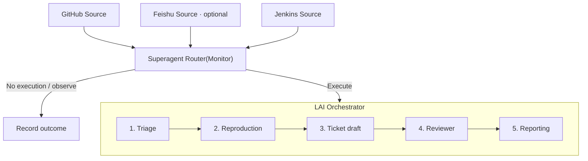
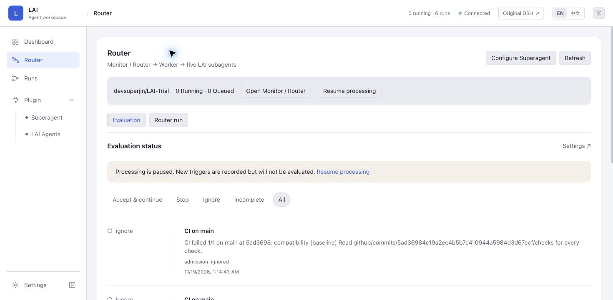
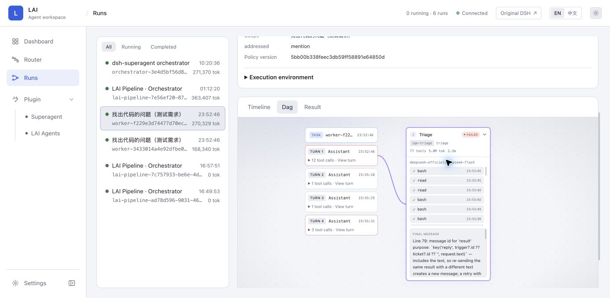
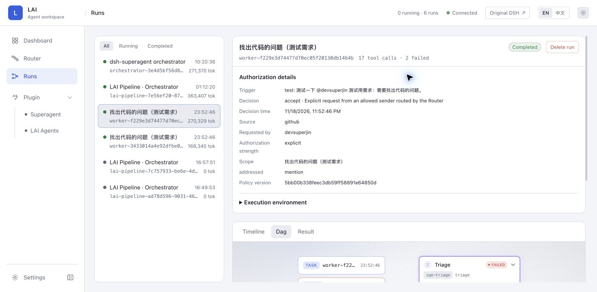
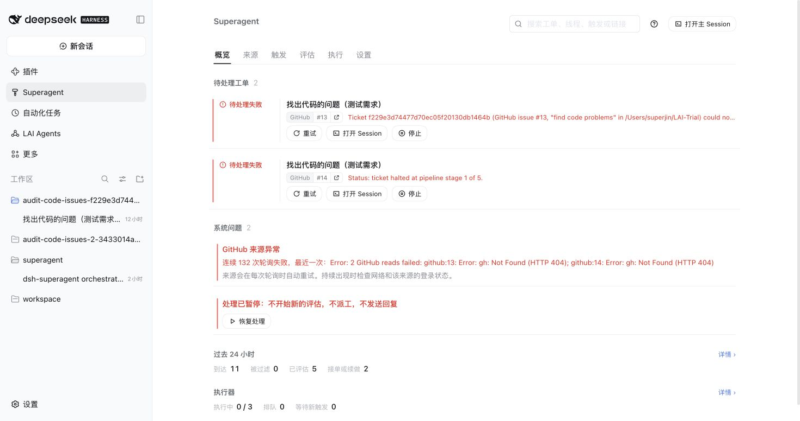

# LAI Trial

**English** | [简体中文](README.zh-CN.md)

## Introduction

LAI is an agent application built on **DeepSeek Harness (DSH)**. **Superagent handles monitoring, routing and task management**, while a **LAI Orchestrator delegates to five specialist subagents** to analyze, reproduce, document, review and report on a task.

The project targets engineering work driven by GitHub, Jenkins CI and optional Feishu conversations: turning failure logs, discussions and code changes into tasks with a visible execution history, supporting evidence and recorded outcomes.

## Goals and design

The original requirements drew on six business roles in a CI validation workflow: **Monitor, Triage, Reproduction, Ticket, Reviewer and Reporting**. The current implementation combines these roles with Superagent and adjusts how they run:

- **Monitor is the Superagent Router(Monitor).** It receives events, decides whether work should proceed, routes tasks and handles follow-up discussions.
- When work is accepted, Superagent creates a task with its own **LAI Orchestrator session and workspace**.
- The LAI Orchestrator coordinates execution using LAI's `iqe-orchestrator` preset and invokes the five specialists in sequence.
- The specialists are native DSH child agents. Their calls, execution history and results are visible in both lai-web and the original DSH interface.

“Six agents” describes the six business roles. The runtime also includes an LAI Orchestrator session. Superagent Router(Monitor) and LAI Orchestrator are separate sessions linked through a task; the five specialists are children of the LAI Orchestrator.



Superagent Router(Monitor) represents event intake, admission checks, assessment and routing. LAI Orchestrator coordinates its five child agents; task/assignment bookkeeping, workspace details and result handling are omitted from this overview.

This overview is identical to the diagram in [the design document](docs/design.md#2-overall-structure). The five stages are children of LAI Orchestrator: stage arrows show order, and LAI Orchestrator starts each child after the previous one finishes. The Ticket stage produces a draft; the Superagent Ticket is the task entity. Replies do not automatically re-enter intake; only a later external event can become new input.

### Roles

| Business role | Implementation | Responsibilities |
| --- | --- | --- |
| Monitor | Superagent Router(Monitor) | Receive events, evaluate admission, associate tasks, dispatch LAI Orchestrator instances and handle follow-ups |
| Triage | `iqe-triage` / `triage` | Gather evidence, analyze failures and separate established facts from hypotheses |
| Reproduction | `iqe-reproduction` / `reproduce` | Reproduce and validate issues; make necessary changes for explicitly authorized fixes |
| Ticket | `iqe-ticket` / `ticket` | Organize the problem, root cause, reproduction steps and evidence into a ticket draft or change summary |
| Reviewer | `iqe-reviewer` / `review` | Independently inspect the diagnosis, reproduction and changes, then provide a review decision |
| Reporting | `iqe-reporting` / `reporter` | Consolidate results, evidence, review conclusions and unresolved questions |

**Execution order is fixed: `triage → reproduce → ticket → review → reporter`.** Each stage waits for its child agent to actually finish. Runtime guards inspect native child-session history and prevent duplicate, out-of-order or concurrent stage launches. A failed or cancelled child blocks later stages. The LAI Orchestrator can report `ready` only after all five stages complete.

A Superagent **Ticket is a task-management entity**. The LAI **Ticket Agent is one execution stage** within that task.

### Component responsibilities

| Component | Owns |
| --- | --- |
| DSH | Model integration, persistent sessions, tools, native subagents, permissions and the plugin runtime |
| Superagent | Sources, Policy, Superagent Router(Monitor), task state, LAI Orchestrator lifecycle, scheduling, retries and replies to sources |
| LAI Agents | LAI Orchestrator coordination preset, five specialist roles, configurable prompts and sequential execution guards |
| lai-web | Unified views for tasks, sessions, execution, configuration and results |

## Current capabilities and extensions

| Capability | Current implementation |
| --- | --- |
| Event sources | GitHub repository events, Jenkins failed builds, and an optional Feishu conversation Source. Each source has its own configuration and intake scope. |
| Monitoring and routing | Superagent Router(Monitor) receives events, applies admission policy, assesses candidates and manages task routing and follow-ups. |
| Task execution | LAI Orchestrator coordinates five native child agents in order: Triage → Reproduction → Ticket draft → Reviewer → Reporting. Failed or cancelled stages block later stages. |
| Tools and Skills | Per-specialist model/tool configuration, default Skill capability and on-demand Skill loading. Standalone Feishu tools provide separately configured operation capabilities. |
| Service credentials | A dedicated Credentials plugin stores connection information and secrets with preset-based access grants and optional local credential updates. |
| Execution visibility | Dashboard, task decisions, native Run timelines/DAGs/results and configuration pages share the same backend and execution history as the original DSH UI. |

Source availability, model configuration, tool selection and task authorization determine what can actually run. Receiving an event does not by itself authorize execution; a role or Skill does not grant access to an external service. Publishing replies, PRs or tickets requires the applicable authorization and working tools.

Extend inputs through Superagent Sources and add capabilities through standard DSH tool/Skill plugins. Configuration steps and current access controls are covered in the [configuration guide](docs/guide.md); plugin development is covered in the [development guide](docs/development.md).

## Quick start

Requirements:

- Node.js **24.9.0 or later**, as required by this repository.
- pnpm **11.28.5**, declared in `package.json`.
- For the GitHub source, an executable, authenticated GitHub CLI (`gh`) whose account has the required repository access.
- A configured model provider and credentials.

First run:

```sh
pnpm install
pnpm start
```

`pnpm start` builds the workspace and starts the unified application. You do not need separate frontend and backend processes for normal use. Open the authenticated URL printed in the terminal. The default port is **3080**.

For configuration steps and page details, see the [configuration guide](docs/guide.md).

## Repository structure

```text
LAI-Trial/
├── app/
│   └── lai-web/                 # React + Tailwind CSS frontend
├── config/
│   ├── dsh-baseline.json         # Official DSH version and source baseline
│   ├── profile.json              # Application Profile / Bundle composition
│   └── cordis.patch.yml          # Default plugins and environment configuration
├── packages/
│   └── dsh-adapter/              # Browser RPC, Superagent API and DSH compatibility
├── plugins/
│   ├── superagent/               # @lai/superagent: intake, routing, tasks and LAI Orchestrator instances
│   │   └── src/app/lai-worker.ts # Five-stage native subagent execution guards
│   ├── lai-agents/               # @lai/lai-agents: LAI Orchestrator and five specialist presets
│   └── web-host/                 # Unified Web hosting, authentication and DSH debug UI
├── scripts/                      # Startup, Profile migration, version and architecture checks
├── tests/                        # Application contracts and composition migration tests
├── docs/                         # Architecture, migration and maintenance documentation
├── .github/workflows/            # DSH baseline and candidate compatibility checks
└── .runtime/                     # Local runtime data, excluded from Git
```

`plugins/superagent` contains application business logic imported from the Superagent prototype, with its MIT license retained. The imported baseline is `8c32a9dc5d72c033816c6a8110b37f40cf94fba4`. Local additions include DSH compatibility, own-Issue intake, management API authentication and the LAI Orchestrator pipeline. This is an application plugin maintained in this repository; it does not modify official DSH framework source.

### Runtime data

| Path / setting | Contents |
| --- | --- |
| `.runtime/dsh` | Isolated application DSH Home: user settings, credentials and sessions |
| `.runtime/dsh/superagent` | Default Superagent database and execution-state directory |
| `LAI_SUPERAGENT_STATE_DIR` | Optional absolute path overriding the Superagent state directory |
| `.reference` | Ignored upstream source checkout for auditing; never used by builds, tests or runtime |

## Screenshots

### Superagent Router(Monitor) evaluation

Routing and admission are native Superagent capabilities. LAI provides a dedicated Superagent Router(Monitor) page to show how incoming events are assessed against sender authorization, policy and evaluation settings to decide whether to accept, continue, stop or ignore work. Accepted work can be opened directly in Runs.



### LAI Orchestrator DAG

Native LAI Orchestrator Turns, specialist delegation and execution status in Runs.



### Authorization details

Trigger, admission decision, requester, scope and policy version, with execution environment details available below.



### Superagent in the original DSH interface

The original Superagent panel remains accessible through `/dsh/`, sharing task state and execution records.



## Documentation

- [Development guide](docs/development.md): dependencies, composition, lifecycle, versions and checks.

- [Configuration guide](docs/guide.md): initial setup, page reference, tools and credential authorization.

- [System design](docs/design.md) · [中文](docs/design.zh-CN.md)
- [Architecture](docs/architecture.md) · [中文](docs/architecture.zh.md)

Repository configuration and scripts are the source of truth for dependencies and startup behavior.
