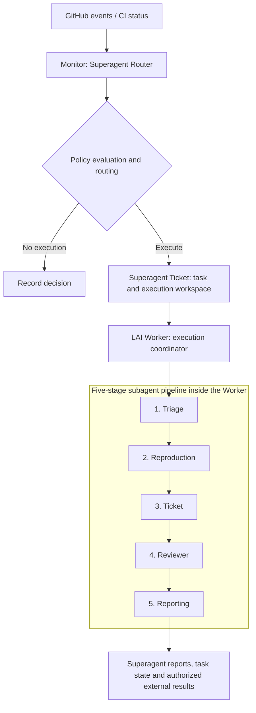

# LAI Trial

**English** | [简体中文](README.zh-CN.md)

LAI is an agent application built on **DeepSeek Harness (DSH)**. **Superagent handles monitoring, routing and task management**, while a **LAI Worker delegates to five specialist subagents** to analyze, reproduce, document, review and report on a task.

The project targets CI- and GitHub-driven engineering work: turning failure logs, discussions and code changes into tasks with a visible execution history, supporting evidence and recorded outcomes.

## Goals and design

The original requirements drew on six business roles in a CI validation workflow: **Monitor, Triage, Reproduction, Ticket, Reviewer and Reporting**. The current implementation combines these roles with Superagent and adjusts how they run:

- **Monitor is the Superagent Router.** It receives events, decides whether work should proceed, routes tasks and handles follow-up discussions.
- When work is accepted, Superagent creates a task with its own **Worker session and workspace**.
- The Worker coordinates execution using LAI's `iqe-orchestrator` preset and invokes the five specialists in sequence.
- The specialists are native DSH child agents. Their calls, execution history and results are visible in both lai-web and the original DSH interface.

“Six agents” describes the six business roles. The runtime also includes a Worker coordination session. Monitor / Router and Worker are separate sessions linked through a task; the five specialists are children of the Worker.



### Roles

| Business role | Implementation | Responsibilities |
| --- | --- | --- |
| Monitor | Superagent Router | Receive events, evaluate admission, associate tasks, dispatch Workers and handle follow-ups |
| Triage | `iqe-triage` / `triage` | Gather evidence, analyze failures and separate established facts from hypotheses |
| Reproduction | `iqe-reproduction` / `reproduce` | Reproduce and validate issues; make necessary changes for explicitly authorized fixes |
| Ticket | `iqe-ticket` / `ticket` | Organize the problem, root cause, reproduction steps and evidence into a ticket draft or change summary |
| Reviewer | `iqe-reviewer` / `review` | Independently inspect the diagnosis, reproduction and changes, then provide a review decision |
| Reporting | `iqe-reporting` / `reporter` | Consolidate results, evidence, review conclusions and unresolved questions |

**Execution order is fixed: `triage → reproduce → ticket → review → reporter`.** Each stage waits for its child agent to actually finish. Runtime guards inspect native child-session history and prevent duplicate, out-of-order or concurrent stage launches. A failed or cancelled child blocks later stages. The Worker can report `ready` only after all five stages complete.

A Superagent **Ticket is a task-management entity**. The LAI **Ticket Agent is one execution stage** within that task.

### Component responsibilities

| Component | Owns |
| --- | --- |
| DSH | Model integration, persistent sessions, tools, native subagents, permissions and the plugin runtime |
| Superagent | Sources, Policy, Router, task state, Worker lifecycle, scheduling, retries and replies to sources |
| LAI Agents | Worker coordination preset, five specialist roles, configurable prompts and sequential execution guards |
| lai-web | Unified views for tasks, sessions, execution, configuration and results |

## Current capabilities and extensions

The application integrates Superagent's GitHub source. Depending on configuration, it receives notifications, new Issues, PRs, comments and CI status changes, then applies admission policy. Accepted work runs through LAI's native subagent pipeline.

Current boundaries:

- **Receiving an event does not automatically launch a Worker.** Source switches, allowed senders, admission rules and Eval mode determine what proceeds. The prototype's default rules mainly cover copy fixes and local visual fixes; CI analysis requires appropriate rules.
- Role behavior depends on prompts and available tools. A role name does not mean Jarvis, LogDistiller or another external engineering tool is installed.
- Dedicated Jenkins integration, general Commit / Push triggers, Jira / Azure ticket-submission connectors and a shared knowledge base are not currently implemented. Future inputs should use Superagent's Source extension mechanism.
- Tasks can produce ticket drafts and reports. Creating PRs, replying on GitHub or taking other external actions depends on authorization, configuration and available tools.

## Quick start

Requirements:

- Node.js **24.9.0 or later**, as required by this repository.
- pnpm **11.28.5**, declared in `package.json`.
- For the GitHub source, an executable, authenticated GitHub CLI (`gh`) whose account has the required repository access.
- A configured model provider and credentials.

First run:

```sh
pnpm install
pnpm start
```

`pnpm start` builds the workspace and starts the unified application. You do not need separate frontend and backend processes for normal use. Open the authenticated URL printed in the terminal. The default port is **3080**.

### Initial configuration

1. In **Settings**, configure model providers, credentials and the default model. Configure LAI role prompts and specialist model overrides in **Plugin → LAI Agents**.
2. Open **Plugin → Superagent → Sources** and configure the GitHub repository (`owner/repo`), GitHub CLI path and events to receive.
3. In **Policy**, configure allowed senders, task scope and admission rules.
4. In **Eval**, configure evaluation mode, timeout and the Router model. The default is `observe`; choose `auto` when the intended workflow should automatically accept inferred tasks under policy.
5. In **Execution**, configure the Worker model, concurrency, working directory, workspace preparation command and command restrictions.
6. Use **Router** to inspect accepted work and **Runs** to inspect Router, Worker and subagent execution.

If one GitHub account both opens Issues and executes tasks, enable new-Issue intake and **Receive issues opened by the agent account**. Own comments and PRs remain filtered. This switch does not replay previously skipped Issues, and received Issues still pass through Policy.

The minimum polling interval is 60 seconds; longer intervals requested by GitHub take precedence. Start with a small, clearly defined task to inspect routing behavior and model costs.

## Pages and configuration

| Page | Purpose |
| --- | --- |
| Dashboard | Superagent intake and task metrics, Router / Worker health, five-stage activity and recorded model usage |
| Router | Superagent tasks with links to their Monitor / Router and Worker sessions |
| Runs | Timeline with Waterfall / List views, grid-backed DAG, native subagents and execution results |
| Plugin → Superagent | Dedicated management page for Sources, Policy, Eval, Execution, Prompts and Deployment |
| Plugin → LAI Agents | Worker and specialist prompts, plus per-specialist model overrides |
| Settings | General: appearance, language and version information; Model configuration: providers, credentials and the default model |

The interface supports English and Chinese. The original DSH debugging UI remains available at **`/dsh/`**, sharing the same backend. Deleting a Run uses native DSH archiving with Undo; running sessions must be stopped first.

**Prompts** on the Superagent page manages its Router / Worker instructions. **Plugin → LAI Agents** manages LAI role definitions and specialist model overrides. It is an independent DSH Bundle with its own sidebar and configuration entry in the original DSH interface. Unpinned specialists inherit the Worker model; pinned routes apply to new children without changing the global default. Source, policy and execution settings use revisions to detect concurrent changes. Advanced editors expose complete configuration fields beyond the basic forms.

## Repository structure

```text
LAI-Trial/
├── app/
│   └── lai-web/                 # React + Tailwind CSS frontend
├── config/
│   ├── dsh-baseline.json         # Official DSH version and source baseline
│   ├── profile.json              # Application Profile / Bundle composition
│   └── cordis.patch.yml          # Default plugins and environment configuration
├── packages/
│   └── dsh-adapter/              # Browser RPC, Superagent API and DSH compatibility
├── plugins/
│   ├── superagent/               # @lai/superagent: intake, routing, tasks and Workers
│   │   └── src/app/lai-worker.ts # Five-stage native subagent execution guards
│   ├── lai-agents/               # @lai/lai-agents: Worker and five specialist presets
│   └── web-host/                 # Unified Web hosting, authentication and DSH debug UI
├── scripts/                      # Startup, Profile migration, version and architecture checks
├── tests/                        # Application contracts and composition migration tests
├── docs/                         # Architecture, migration and maintenance documentation
├── .github/workflows/            # DSH baseline and candidate compatibility checks
└── .runtime/                     # Local runtime data, excluded from Git
```

`plugins/superagent` contains application business logic imported from the Superagent prototype, with its MIT license retained. The imported baseline is `8c32a9dc5d72c033816c6a8110b37f40cf94fba4`. Local additions include DSH compatibility, own-Issue intake, management API authentication and the LAI Worker pipeline. This is an application plugin maintained in this repository; it does not modify official DSH framework source.

### Runtime data

| Path / setting | Contents |
| --- | --- |
| `.runtime/dsh` | Isolated application DSH Home: user settings, credentials and sessions |
| `.runtime/dsh/superagent` | Default Superagent database and execution-state directory |
| `LAI_SUPERAGENT_STATE_DIR` | Optional absolute path overriding the Superagent state directory |
| `.reference` | Ignored upstream source checkout for auditing; never used by builds, tests or runtime |

## DSH application development conventions

LAI maintains its extensions in an independent application repository. The current official DSH baseline is **`0.2.2-rc.1`**, recorded in [`config/dsh-baseline.json`](config/dsh-baseline.json).

### Dependencies and plugin composition

- Use the **`@lai`** namespace for application packages. Pin official DSH dependencies and peers to the baseline version.
- Extend DSH through published exports, **Bundle / Profile composition and environment overlays**.
- Do not copy or edit official DSH framework source or import private build paths.
- Keep DSH version differences and the browser RPC protocol in **`packages/dsh-adapter`**.
- Preserve Superagent's ownership of events, routing and task lifecycle. New CI / GitHub inputs should use its Source mechanism without adding a parallel trigger layer or MQ dependency.

### Agents and lifecycle

- Define specialist roles in `plugins/lai-agents`. Workers must invoke native child agents; independent root sessions do not replace parent–child relationships.
- Enforce stage order through runtime guards rather than relying only on prompt instructions.
- Own tool, event, prompt and service registrations through Cordis lifecycle effects and dispose them correctly.
- On shutdown or unload, await task cancellation, child termination and Worker cleanup before releasing dependencies.
- Preserve native sessions, tool calls, execution receipts and durable records so lai-web and the original DSH interface can inspect the same execution.

### Configuration, data and credentials

- Store application defaults in repository configuration and user overrides in the runtime Profile. Upgrades and migrations must preserve existing model settings, credentials and sessions.
- Save configuration through settings interfaces with revision checks to avoid overwriting concurrent changes.
- Manage credentials through DSH's credential interface. Keep them out of committed configuration, source and examples.
- Keep `.runtime` separate from other user DSH data and excluded from Git.

### Validation and upstream upgrades

For integration changes, run:

```sh
pnpm check
```

This checks architecture, builds, types and local tests, including Superagent fixtures. Pipeline tests use deterministic drivers and local data. Real-model validation is separate and incurs actual API costs.

Upgrade DSH on a separate integration branch. Select an exact release, update dependencies and the lockfile, review public interfaces and persistence formats, and complete compatibility checks before merging. The repository provides a version-update script:

```sh
node scripts/set-dsh-version.mjs <exact-version>
pnpm install --no-frozen-lockfile
pnpm check
```

Update the baseline record and retain the previous code, lockfile and matching data backups. When updating Superagent business logic, preserve LAI's Worker preset, sequential guards, management API authentication and own-Issue configuration.

## Development commands

| Command | Purpose |
| --- | --- |
| `pnpm start` | Build and start the unified application |
| `pnpm build` | Build all workspace packages |
| `pnpm start:backend` | Start the backend from existing builds without opening a browser |
| `pnpm dev:web` | Start the frontend development server; requires a backend |
| `pnpm config:dump` | Inspect the composed DSH configuration |
| `pnpm check:architecture` | Check namespaces, dependency versions and import boundaries |
| `pnpm check` | Run the complete local check suite |

See [`docs/architecture.md`](docs/architecture.md) for detailed runtime relationships. Repository configuration and scripts are the source of truth for dependencies and startup behavior.
