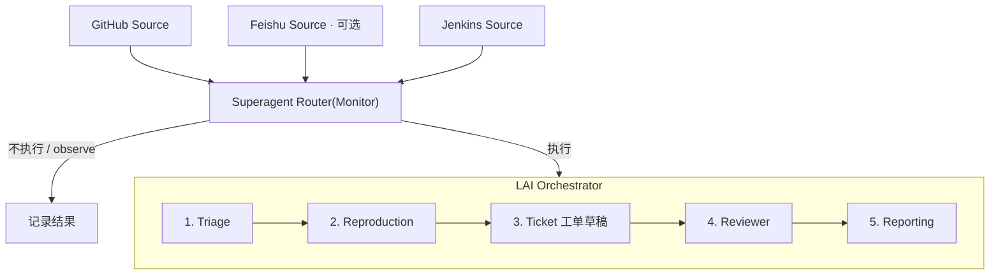
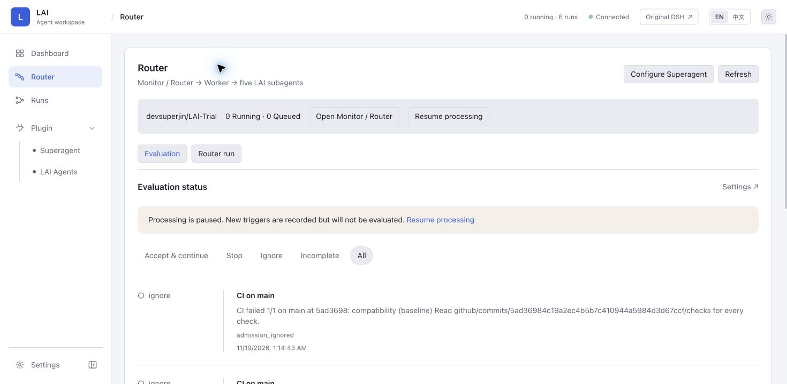
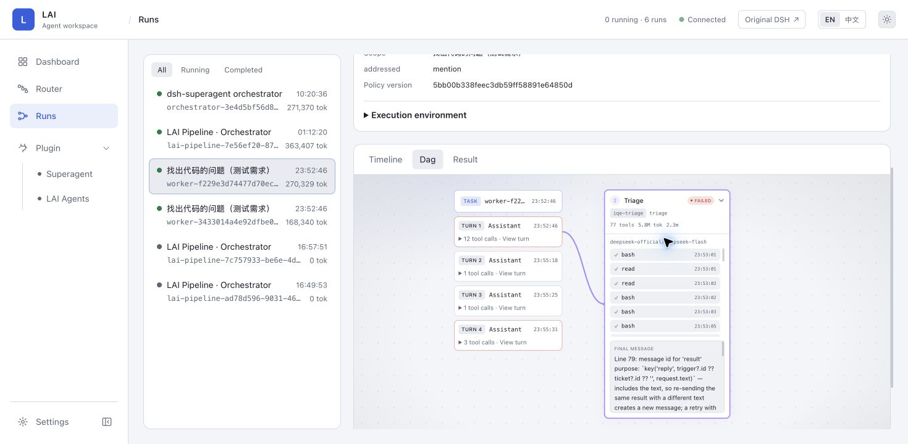
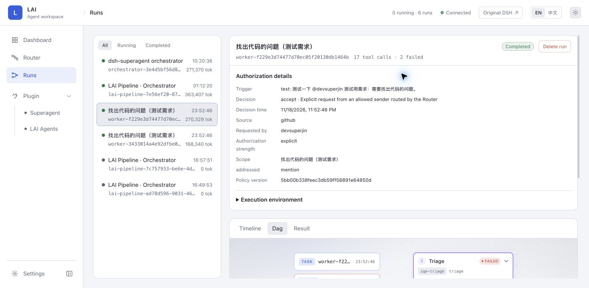
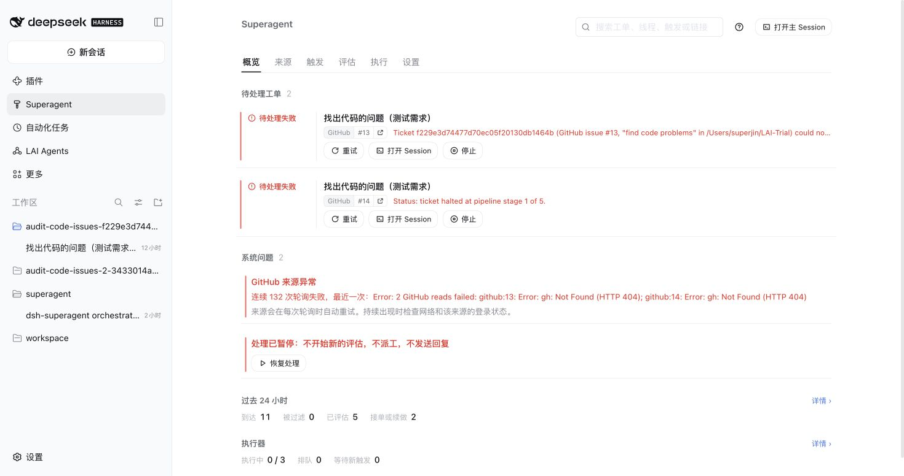

# LAI Trial

[English](README.md) | **简体中文**

## 项目介绍

**LAI（Linux Agent Infra）** 是一个基于 **DeepSeek Harness（DSH）** 二次开发的 Agent 应用：由 **Superagent 负责监控、判断和任务管理**，由 **LAI Orchestrator 调用五个专业子 Agent**，按流水线完成分析、复现、工单整理、审核和报告。

项目面向 GitHub、Jenkins CI 和可选飞书对话驱动的工程任务，希望把分散的失败日志、问题讨论和代码变更转化为有执行过程、有证据、有结果的任务记录。

## 项目需求与设计

最初的需求参考六个业务角色的 CI 验证流程：**Monitor、Triage、Reproduction、Ticket、Reviewer、Reporting**。当前实现结合了 Superagent，并调整了它们的运行方式：

- **Monitor 就是 Superagent Router(Monitor)**，负责接收事件、判断任务是否应当执行，以及任务路由和后续讨论。
- Superagent Router(Monitor) 决定执行后，通过 Superagent 创建任务及其 **LAI Orchestrator 会话和工作区**。
- LAI Orchestrator 是执行协调者，使用 LAI 的 `iqe-orchestrator` 预设，依次调用五个专业子 Agent。
- 五个子 Agent 是 DSH 原生的父子 Agent，调用记录、执行过程和结果可以在 lai-web 和原版 DSH 中查看。

这里的“六个 Agent”指六类业务角色。实际运行结构还包含一个 LAI Orchestrator 协调会话；Superagent Router(Monitor) 和 LAI Orchestrator 是通过任务关联的独立会话，五个专业 Agent 才是 LAI Orchestrator 的子 Agent。



Superagent Router(Monitor) 统一表示事件接入、准入检查、评估与路由职责。 LAI Orchestrator 协调五个子 Agent；本图省略任务／派工记录、工作区及结果处理细节。

本图与[设计文档](docs/design.zh-CN.md#2-总体结构)的总体结构图保持一致。五个阶段都是 LAI Orchestrator 的子 Agent：连线只表示先后顺序，每个子 Agent 都由 LAI Orchestrator 在前一阶段结束后启动。Ticket 阶段产出工单草稿，Superagent Ticket 则是任务实体。回复不会自动回灌到接入流程，只有后续外部事件才可能成为新输入。

### 角色分工

| 业务角色 | 当前实现 | 主要职责 |
| --- | --- | --- |
| Monitor | Superagent Router(Monitor) | 接收来源事件、执行准入判断、关联任务、调度 LAI Orchestrator、处理后续消息 |
| Triage | `iqe-triage` / `triage` | 收集证据、分析失败原因、区分已知事实和待验证假设 |
| Reproduction | `iqe-reproduction` / `reproduce` | 受控复现和验证；对明确授权的修复任务实施必要修改 |
| Ticket | `iqe-ticket` / `ticket` | 整理问题描述、根因、复现步骤和证据，形成工单草稿或变更说明 |
| Reviewer | `iqe-reviewer` / `review` | 独立检查分析、复现和修改结果，给出审核意见 |
| Reporting | `iqe-reporting` / `reporter` | 汇总结果、证据、审核结论和未解决问题 |

**执行顺序固定为 `triage → reproduce → ticket → review → reporter`。** 每一步必须等待当前子 Agent 真实完成，才能进入下一步。执行约束会检查原生子会话历史，并阻止重复、越序及同时启动多个阶段；子 Agent 失败或取消后，不再启动后续阶段。只有五个阶段全部完成，LAI Orchestrator 才能提交 `ready` 报告。

Superagent 的 **Ticket 是任务管理实体**，LAI 的 **Ticket Agent 是其中一个执行阶段**，两者承担不同职责。

### Superagent 与 LAI 的边界

| 部分 | 负责的能力 |
| --- | --- |
| DSH | 模型接入、会话持久化、工具、原生子 Agent、权限及插件运行环境 |
| Superagent | Sources、Policy、Superagent Router(Monitor)、任务状态、LAI Orchestrator 生命周期、调度、重试和来源回复 |
| LAI Agents | LAI Orchestrator 协调预设、五个专业角色、可配置 Prompt、串行执行约束 |
| lai-web | 统一的任务、会话、执行过程、配置和结果查看界面 |

## 术语速查

| 术语 | 含义 |
| --- | --- |
| LAI | Linux Agent Infra。 |
| Superagent Router(Monitor) | 监控、准入、评估和任务路由角色。 |
| LAI Orchestrator | 使用 `iqe-orchestrator` 协调五个原生子 Agent 的执行角色。 |
| Ticket / Run | Ticket 是业务任务；Run 是原生会话的执行记录。 |
| Tool / Skill | Tool 提供可执行能力；Skill 提供按需加载的操作说明，不自动授予权限。 |

完整定义见[术语表](docs/glossary.zh-CN.md)，应用内可在 **Settings → 术语表** 查看。

## 当前能力与扩展方向

| 能力 | 当前实现 |
| --- | --- |
| 事件来源 | GitHub 仓库事件、Jenkins 失败构建，以及可选飞书对话来源；每个来源分别配置接收范围。 |
| 监控与路由 | Superagent Router(Monitor) 接收事件、执行准入策略、评估候选，并管理任务路由及后续消息。 |
| 任务执行 | LAI Orchestrator 按顺序协调五个原生子 Agent：Triage → Reproduction → Ticket 工单草稿 → Reviewer → Reporting；失败或取消会阻止后续阶段。 |
| 工具与 Skill | 专业角色可分别配置模型和工具，默认具备 Skill 能力并按需加载；独立飞书工具提供另行配置的操作能力。 |
| 服务凭证 | 独立 Credentials 插件管理连接信息和密钥，按 preset 授权访问，并可显式允许更新本地凭证。 |
| 执行可见性 | Dashboard、任务判断、原生 Run 时间线／DAG／结果及配置页面，与原版 DSH 共用后端和执行历史。 |

实际执行能力取决于来源是否可用、模型配置、工具选择及任务授权。收到事件不等于获准执行，角色或 Skill 也不会自动授予外部服务权限。回复、PR 或工单发布仍需对应授权和可用工具。

新增输入通过 Superagent Source 扩展，新增能力通过标准 DSH 工具／Skill 插件扩展。配置步骤和访问控制见[配置手册](docs/guide.zh-CN.md)，插件开发见[开发手册](docs/development.zh-CN.md)。

## 快速启动

环境要求：

- Node.js **24.9.0 或以上**，满足本仓库的运行要求。
- pnpm **11.28.5**，版本声明见 `package.json`。
- 使用 GitHub 来源时，需要可执行且已登录的 GitHub CLI（`gh`），登录账号须具备目标仓库所需权限。
- 可用的模型 Provider 与凭据。

首次运行：

```sh
pnpm install
pnpm start
```

`pnpm start` 会构建工作区并启动统一应用，无需分别启动前端和后端。打开终端打印的带认证信息的访问地址，默认端口为 **3080**。

配置步骤与页面说明请查看[配置手册](docs/guide.zh-CN.md)。

## 项目结构

```text
LAI-Trial/
├── app/
│   └── lai-web/                 # React + Tailwind CSS 前端
├── config/
│   ├── dsh-baseline.json         # 官方 DSH 版本与来源基线
│   ├── profile.json              # 应用 Profile / Bundle 组合
│   └── cordis.patch.yml          # 应用默认插件及环境配置
├── packages/
│   └── dsh-adapter/              # 浏览器 RPC、Superagent API 与 DSH 版本适配
├── plugins/
│   ├── superagent/               # @lai/superagent：接入、路由、任务与 LAI Orchestrator 生命周期
│   │   └── src/app/lai-worker.ts # LAI 五阶段子 Agent 的执行约束
│   ├── lai-agents/               # @lai/lai-agents：LAI Orchestrator 与五个专业角色预设
│   └── web-host/                 # 统一 Web 服务、鉴权及原版 DSH 调试入口
├── scripts/                      # 启动、Profile 迁移和版本 / 架构检查
├── tests/                        # 应用契约与组合迁移测试
├── docs/                         # 架构、迁移与维护文档
├── .github/workflows/            # DSH 基线与候选版本兼容性检查
└── .runtime/                     # 本地运行数据，不提交到 Git
```

`plugins/superagent` 来自 Superagent 原型的业务代码，原有 MIT 许可保留。当前导入基线为 `8c32a9dc5d72c033816c6a8110b37f40cf94fba4`；在此基础上增加了 DSH 版本适配、同账号 Issue 接收、管理 API 鉴权和 LAI Orchestrator 流水线。它是本仓库维护的应用插件，不是对官方 DSH 框架源码的修改。

### 运行数据

| 路径 / 配置 | 内容 |
| --- | --- |
| `.runtime/dsh` | 应用隔离的 DSH Home，保存用户配置、凭据和会话 |
| `.runtime/dsh/superagent` | 默认 Superagent 数据库及执行状态目录 |
| `LAI_SUPERAGENT_STATE_DIR` | 可覆盖 Superagent 状态目录，须为绝对路径 |
| `.reference` | 忽略提交的上游源码审计目录，不参与构建、测试或运行 |

## 项目截图

### Superagent Router(Monitor) 自动判断

路由与准入判断是 Superagent 的原生能力，LAI 为其提供独立的 Superagent Router(Monitor) 展示页面。系统根据发送者授权、策略与评估配置，判断收到的事件是否需要接单、续做、停止或忽略；受理后可直接打开对应的 Runs。



### LAI Orchestrator DAG

在 Runs 中查看 LAI Orchestrator 的原生 Turn、专业子 Agent 委派和执行状态。



### 授权详情

展示任务触发、准入决定、发起人、授权范围和策略版本，下方可展开执行环境。



### 原版 DSH 中的 Superagent

通过 `/dsh/` 保留原版 Superagent 管理页面，与 lai-web 共享任务状态及执行记录。



## 项目文档

- [术语表](docs/glossary.zh-CN.md)：统一名称和概念。

- [开发手册](docs/development.zh-CN.md)：依赖、插件组合、生命周期、版本及检查流程。

- [配置手册](docs/guide.zh-CN.md)：首次配置、页面入口、工具与凭证授权。

- [系统设计](docs/design.zh-CN.md) · [English](docs/design.md)
- [架构说明](docs/architecture.zh.md) · [English](docs/architecture.md)

具体依赖与启动脚本以仓库当前配置为准。
