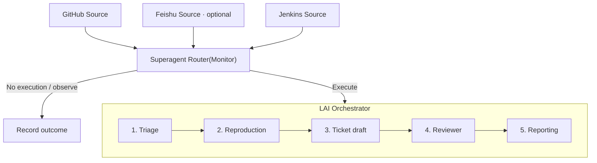

# LAI Superagent System Design

**English** | [简体中文](design.zh-CN.md)

This document describes the current implementation and its extension boundaries for maintainers and plugin developers. See the [README](../README.md) for startup instructions and [architecture.md](architecture.md) for DSH integration constraints.

## 1. Goals and use cases

LAI-Superagent combines event intake, task assessment and specialist execution to investigate engineering problems and deliver traceable results. Inputs include GitHub Issues, PRs, comments and CI status, Feishu conversations, and Jenkins CI failures. Accepted tasks run in independent workspaces through analysis, reproduction, ticket preparation, review and reporting.

The original six-role reference diagram describes business responsibilities. The implementation adapts it as follows:

- Superagent Router(Monitor) performs the Monitor role, processing events and follow-up messages.
- Superagent Router(Monitor) assesses and dispatches work; a separate LAI Orchestrator coordinates each task.
- LAI Orchestrator delegates to five specialist subagents in a strict sequence.
- Execution uses native DSH parent–child agents and tool events. lai-web and the original DSH interface inspect the same records.

“Continuous” means the service keeps receiving and processing events. Superagent Router(Monitor) can be idle between inputs; it does not continuously generate model output or incur model usage merely by remaining available.

## 2. Overall structure

Superagent Router(Monitor) represents event intake, admission checks, assessment and routing. LAI Orchestrator coordinates its five child agents; task/assignment bookkeeping, workspace details and result handling are omitted from this overview.

This overview is identical to the diagram in the [README](../README.md#goals-and-design). Receiving an event does not imply execution; observe-only or filtered outcomes do not start an LAI Orchestrator.

All five specialists are native children of LAI Orchestrator. Edges between stages represent execution order, not one specialist creating another. LAI Orchestrator issues each delegation. The Ticket stage produces a draft; the Superagent Ticket is the task entity. Results do not automatically loop back into intake; later external events enter through a Source.

### Core objects

| Object | Responsibility |
| --- | --- |
| Source | Receives external events and declares scope, context-reading and reply capabilities |
| Trigger | Normalized input event used for assessment and traceability |
| Thread | Conversation or topic linking follow-up messages and tasks |
| Decision | Records acceptance, continuation, stopping, ignoring or unavailable assessment, with reasons |
| Ticket | Business task managed by Superagent, linking inputs, workspace and execution records |
| Assignment | One dispatch of a Ticket; subsequent assignments use their own time range to identify stage progress |
| Run | lai-web's interface term for native DSH session execution records |

Tickets and Runs represent different concerns: a Ticket tracks the business task lifecycle, while a Run records agent execution. Superagent Router(Monitor) and LAI Orchestrator have separate Runs; the five specialists are child Runs of LAI Orchestrator. These are neither a single session nor six unrelated root sessions.

## 3. Modules and ownership

| Module | Responsibilities | Boundary |
| --- | --- | --- |
| Official DSH | Models, sessions, tool execution, native subagents, permissions and plugin runtime | Use published interfaces without modifying framework source |
| `plugins/superagent` | Sources, admission, Superagent Router(Monitor), Tickets, LAI Orchestrator scheduling, retries and replies | Owns event and business task lifecycles |
| `plugins/lai-agents` | LAI Orchestrator and five specialist presets, prompts and role model overrides | Does not implement separate event intake or scheduling |
| `plugins/credentials` | Preset-authorized local credential tools, explicit update permission and scoped Skill | Separate from model-provider credentials; no automatic remote rotation |
| `plugins/feishu-tools` | Standalone Feishu operation tools and credentials | Does not replace the Superagent Feishu input Source |
| `packages/dsh-adapter` | Browser RPC, Superagent HTTP protocol and DSH compatibility reads | Keeps protocol and version differences out of individual UI components |
| `plugins/web-host` | Frontend hosting, authentication, archive discovery and original DSH entry | Does not decide whether business tasks are complete |
| `app/lai-web` | Dashboard, Superagent Router(Monitor), Runs, plugin configuration, model and appearance settings | Presents actual state rather than replacing execution state |
| `config` | Application defaults and Profile / Bundle composition | Runtime user settings do not become repository defaults |

`plugins/superagent` contains imported and modified application business logic; `plugins/lai-agents` is a LAI-owned Bundle. Neither is official DSH framework source.

## 4. Intake, assessment and dispatch

### Event processing

1. A Source receives an event and normalizes it into a Trigger, retaining source identifiers and context references.
2. Superagent checks whether the Source is enabled, whether the event is in scope, and applicable sender and admission rules.
3. Explicit requests, policy and evaluation settings determine the Decision. Not every event requires a model call.
4. Work creates or attaches to a Ticket and is dispatched to its LAI Orchestrator. Follow-up messages can remain associated with existing work.
5. LAI Orchestrator reports its outcome. Superagent maintains task state and sends external replies within the applicable authorization.

“Received,” “admitted” and “executed” are separate states. Source switches control intake scope; they do not authorize arbitrary messages to execute code.

### GitHub

GitHub uses the configured GitHub CLI identity for intake and authorized operations. Repository selection, event switches, allowed senders and admission rules are separate settings.

The project supports opt-in intake of new Issues opened by the agent account itself. This does not enable all automated comments or PR events from that account; reply-loop prevention remains in place.

### Feishu

The optional Feishu Source uses a bot-only `lark-cli`, receiving live events through `event consume im.message.receive_v1 --as bot`. It also supports history recovery, subscribed-thread polling and replies in the originating conversation.

The bot CLI must use `strict-mode bot`. Intake scope includes specified chats with mentions-only or all-message modes, mentions in other chats, and direct messages. Policy controls who may originate work. The Bundle disables this plugin by default; enabling it requires bot deployment and configuration.

The current lai-web basic Source form handles text, switches, numbers and selects. It does not yet cover `rows` fields such as Feishu chat lists; use advanced configuration or the original Superagent interface for those fields.

### Jenkins

The Jenkins Source reads Jenkins' own remote API directly (URL must be explicitly configured), with an optional user and API token for instances that do not allow anonymous read. It discovers jobs, including folders and multibranch projects, reads each job's recent builds, and receives each finished, non-replay `FAILURE` build once with its branch, commit, failed stage and native rerun count, optionally attaching the end of the build's console text. A `jobs` list limits the scan to named jobs. The Source plugin needs no account CLI. Without a configured URL it stays paused and makes no requests; explicitly configured unreachable servers report polling failures.

Failures are senderless machine events. Their only admission cell is the failures row's unlisted, unaddressed cell, which a fresh installation admits as an inferred candidate. With the default Eval mode, observe, accepted work is recorded as `would_accept` rather than a Ticket.

## 5. LAI Orchestrator and five-stage execution

| Stage | Preset | Delegation tool | Main output |
| --- | --- | --- | --- |
| LAI Orchestrator | `iqe-orchestrator` | Invokes the five tools below | Context handoff, stage coordination and final reporting |
| Triage | `iqe-triage` | `triage` | Failure classification, root-cause analysis and evidence |
| Reproduce | `iqe-reproduction` | `reproduce` | Reproduction steps and observations; minimal fixes when explicitly authorized |
| Ticket | `iqe-ticket` | `ticket` | Ticket draft, change description and evidence |
| Review | `iqe-reviewer` | `review` | Independent review and identified problems |
| Reporter | `iqe-reporting` | `reporter` | Consolidated report, evidence and unresolved issues |

Runtime constraints live in `plugins/superagent/src/app/lai-worker.ts`:

- One stage delegation is admitted at a time, in the order `triage → reproduce → ticket → review → reporter`.
- A stage must finish and return its actual child result before the next stage starts.
- Generic `subagent` calls cannot bypass the five designated delegation tools.
- Native child records establish completion; a model's claim alone is insufficient.
- Failed or cancelled children block subsequent stages; LAI Orchestrator cannot skip them and report readiness.
- LAI Orchestrator may report `ready` only after all stages finish. External publication still requires authorization and delivery requirements to be satisfied.

Execution is sequential inside each LAI Orchestrator. Different Tickets may run concurrently according to Superagent's Execution settings.

Role names do not imply that external engineering tools are installed. Jarvis, LogDistiller, Jenkins, Jira and Azure integrations require actual tools or connectors.

## 6. Tools and permissions

Tool capability has three layers:

1. **Registration and mounting:** a tool plugin registers its name, description, parameters, execution function and output format through DSH. Each agent's Preset determines which tool plugins are loaded.
2. **Runtime restrictions:** Superagent restricts Superagent Router(Monitor), LAI Orchestrator and associated subagents, and prevents further work after a Ticket ends. Custom work tools must be included in the relevant allow configuration.
3. **Role instructions:** prompts describe how agents should use tools, but do not replace permission checks.

LAI Agents exposes installed tool groups for per-specialist selection. New Runs retain their selection across settings changes and restarts. Custom plugins use standard `ctx.tools.register`; LAI discovers unconditional global registrations through the public DSH registry (without package ownership metadata); Superagent explicitly checks the approved selection while retaining its Ticket guard. See [the plugin guide](../plugins/lai-agents/README.md#per-specialist-tools).

Tool composition is primarily defined in `plugins/lai-agents/src/definitions.ts`. Superagent's work-tool allowlist and lifecycle restrictions live in `plugins/superagent/src/app/sessions.ts`.

Triage and Review disable direct file-writing tools but retain Shell access, so they are not enforced read-only filesystem roles. Superagent-managed execution uses broad permissions; command wrappers and blocked-command lists are not an OS sandbox. Strong isolation requires a separate execution-environment and permissions design.

New tools should use independent `@lai/tool-*` packages, mounted by the appropriate role Presets. Own registrations and disposal through Cordis effects, and honor cancellation signals for long-running work. A tool's configuration and configuration UI belong to the tool plugin; agents consume its capability through mounting.

### Skills and Credentials

All five specialists enable `skill` by default and mount `@lai/credentials/skill` within their own preset scopes. The `credentials-access` body loads on demand. Role prompts begin with a short hint to consult relevant Skills when context or an approach is missing, without reloading bodies already in context. The LAI Orchestrator does not automatically mount this Skill.

Credentials is a separate plugin/page. Tool selection, enabled/allowedPresets grants and allowUpdates are independent controls. Every call checks the actual preset supplied by DSH execution context; instances of the same preset share a grant. Updates replace only username/token/password on an existing local entry; they do not rotate remote accounts, change grants or create entries.

The compact modal supports endpoint, host/IP, port and notes. Ordinary settings reads are redacted, configured fields show mask dots, and eye icons explicitly reveal stored values. Blank edits preserve old secrets. Retrieved plaintext and update arguments can persist in Run history; revocation cannot retract prior disclosures.

## 7. Configuration and models

| Owner | Configuration | UI entry |
| --- | --- | --- |
| DSH model configuration | Providers, credentials and default model | Settings → Model configuration |
| Superagent | Sources, policy, evaluation mode, Superagent Router(Monitor) / LAI Orchestrator models, concurrency and workspaces | Plugin → Superagent |
| Superagent Prompts | Team agreements, Superagent Router(Monitor) / LAI Orchestrator instructions and built-in section overrides | Plugin → Superagent → Prompts |
| LAI Agents | LAI Orchestrator and specialist prompts, specialist model overrides | Plugin → LAI Agents |
| Browser appearance | Theme, language, sidebar collapse and related preferences | Settings → General and interface controls |

Unpinned specialists follow the inherited model route. Role overrides seed new children without overwriting durable model selections in existing Runs. Superagent manages Superagent Router(Monitor) and LAI Orchestrator model routes; the DSH default model provides the baseline where no explicit route is pinned.

Configuration saves preserve fields not edited by basic forms and use revisions to detect concurrent changes. Credentials remain in runtime settings or the relevant external CLI configuration, never in source, examples or frontend bundles.

The backend composes full prompt previews; the frontend does not duplicate composition logic. Structured section and skill metadata are handled separately from renderable text. Previewing does not start model execution.

## 8. Interface design

The React and Tailwind CSS interface uses a top bar, collapsible sidebar and padded content area. It supports English and Chinese, plus light, dark and system appearance.

| Page | Responsibility |
| --- | --- |
| Dashboard | Superagent intake and acceptance metrics, load and attention items, five-stage activity, recorded model usage and recent Runs |
| Superagent Router(Monitor) | Evaluation status, pause notice and Decision filters by default; Superagent Router(Monitor) run shows ongoing coordination |
| Runs | Native LAI Orchestrator and other Runs, subagents, tool calls and results |
| Plugin → Superagent | Configuration categories on the left and forms on the right; prompt section editing, full previews and history |
| Plugin → LAI Agents | Role prompts and specialist model overrides |
| Settings | General and Model configuration |

Superagent Router(Monitor) has no separate Tasks tab. A Decision's `View run` link resolves its Ticket to the corresponding LAI Orchestrator Run and opens Runs. If no LAI Orchestrator exists yet, it reports that state rather than inventing a record.

Superagent Router(Monitor) run has the fixed title `Superagent` and offers Timeline / DAG without a final Result tab. Ordinary Runs retain Result. Timeline offers both waterfall and list views. DAG uses a grid background and groups tool calls inside Turns to reduce vertical growth.

Dashboard business metrics come from Superagent; token usage comes from each native Run's actual model records. A root Run without child-specific completion projections must not be inferred as failed. Token counts are not billing estimates.

The original DSH debugging interface remains available at `/dsh/` on the same backend. Run deletion uses native archiving with Undo rather than deleting data files directly.

### Shared page structure

`app/lai-web/src/router/routes.tsx` is the single route/menu source: path, component, name, icon, order, group and hideInMenu. Navigation, breadcrumbs, page headings and rendering derive from it. Hash paths support reload and back/forward navigation.

Shared layout lives in `src/layout`, business pages in `src/pages`, and reusable widgets in `src/components`, without page compatibility aliases. Page titles stay outside content cards. Settings plugin versions come from manifests captured at build time, not a live enabled-plugin inventory.

## 9. Protocols and persistence

- Native DSH records provide execution facts for Runs, Turns, tool calls and parent–child agents.
- Superagent persists business tasks, decisions, assignments and execution effects, maintaining retries and external replies.
- `packages/dsh-adapter` wraps browser RPC and `/orchestrator/api/*` management endpoints, converting structured reasons and other responses into UI representations.
- `plugins/web-host` provides application hosting capabilities such as `/lai-api/runs/archives`; authentication relies on existing services rather than an independent frontend identity system.
- `.runtime/dsh` is the application's DSH Home. Superagent defaults to `.runtime/dsh/superagent` for its state directory.
- Configuration, history and archives remain in their owning persistence systems. The UI does not create a separate authoritative task database.

Pausing processing does not end a Ticket or imply that every agent failed. The interface distinguishes intake, assessment, scheduling and execution states.

## 10. Extension rules and development constraints

The current DSH baseline is `0.2.2-rc.1`; `config/dsh-baseline.json` is authoritative.

- Use the `@lai` namespace for application packages and pin official dependencies and peers to the baseline.
- Use published exports, Bundle / Profile composition and environment overlays. Do not copy or modify official framework source.
- Add CI inputs through Superagent Sources. Keep events provider-neutral and preserve existing admission and task lifecycle ownership.
- Add specialist tools through independent plugins with explicit role mounting, input validation, authorization, cancellation and output contracts.
- Configuration pages reuse their plugin's settings and revision checks rather than maintaining disconnected browser copies.
- On shutdown or unload, await cancellation and LAI Orchestrator disposal before releasing dependencies. Own registrations through Cordis effects.
- `.reference` is migration-audit material only, not a build, runtime, test or CI dependency.
- `pnpm check` is the standard integration check. Pipeline tests use deterministic drivers and local fixtures; real-model validation is separate.

### Branches and versions

New plugins start on dedicated branches from current main and merge through PRs, never direct additions on main. Every component update, including docs, bumps that component's manifest: patch for compatible fixes/docs, minor for features, major for breaking changes unless explicitly specified. Application-wide changes also bump the root version. The official DSH baseline remains independent. Respect user limits on checks, tests and browser use; see [AGENTS.md](../AGENTS.md).

## 11. Current scope and extension opportunities

The implemented path combines Superagent intake and task management, LAI's five-stage native subagent execution, unified configuration and execution inspection. Feishu support exists in the plugin but is disabled by default and requires bot deployment. The Jenkins Source receives CI failures directly from the Jenkins remote API.

The following require further development or deployment, beyond changing role prompts:

- CI adapters beyond Jenkins failures, and general Commit / Push triggers.
- Connectors that submit tickets to Jira, Azure or other external systems.
- Enforced filesystem isolation; per-role tool selection is implemented, but Shell access remains a broader capability.
- Complete lai-web forms for every dynamic Source field type.

Extensions should reuse Sources, Presets, tool plugins and configuration interfaces while preserving the boundaries between intake, task coordination, specialist execution and presentation.
