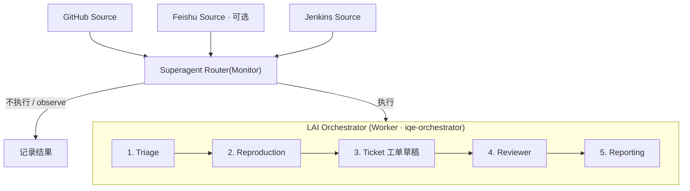

# LAI-Superagent 设计文档

[English](design.md) | **简体中文**

本文描述当前代码的系统设计与扩展边界。面向维护者和插件开发者；启动方法见 [中文 README](../README.zh-CN.md)，DSH 集成约束见 [architecture.md](architecture.md)。

## 1. 目标与使用场景

LAI-Superagent 将事件接入、任务判断和专业 Agent 执行组合起来，用于分析工程问题并交付可追溯的结果。典型输入包括 GitHub Issue、PR、评论、CI 状态，飞书对话，以及 Jenkins 失败构建。系统判断是否需要工作，受理后在独立工作区执行分析、复现、工单整理、审核和报告。

最初的六角色参考图用于描述业务分工，当前实现作了以下调整：

- Monitor 由 Superagent Router 承担，持续处理事件和后续消息。
- Router 判断并派发任务，每个任务由独立 Worker 协调。
- Worker 严格依次调用五个专业子 Agent。
- 运行过程使用 DSH 原生父子 Agent 和工具事件，lai-web 与原版 DSH 可以查看同一份记录。

这里的“持续”指服务循环接收并处理事件，Router 在没有输入时可以空闲，不代表模型持续生成或持续计费。

## 2. 总体结构

Superagent Router(Monitor) 统一表示事件接入、准入检查、评估与路由职责。 LAI Orchestrator 是协调五个子 Agent 的 Worker；本图省略任务／派工记录、工作区及结果处理细节。

本图与 [README](../README.zh-CN.md#项目需求与设计) 的总体结构图保持一致。收到事件不等于执行；被过滤或仅观察的结果不启动 Worker。

图中的五个专业阶段均为 Worker 的原生子 Agent；阶段连线表示先后关系，不表示前一个子 Agent 创建下一个子 Agent。实际委派由 Worker 发起。 Ticket 阶段产出工单草稿，Superagent Ticket 则是任务实体。结果不会自动回灌接入流程，后续外部事件需要通过 Source 接收。

### 核心对象

| 对象 | 职责 |
| --- | --- |
| Source | 接收外部事件，声明来源范围、上下文读取及回复能力 |
| Trigger | 规范化的输入事件，用于后续判断与追溯 |
| Thread | 输入所在的对话或主题，关联后续消息与任务 |
| Decision | 记录接单、续做、停止、忽略或评估不可用等判断及原因 |
| Ticket | Superagent 管理的业务任务，关联输入、工作区和执行记录 |
| Assignment | Ticket 的一次派工；后续派工使用自身时间范围识别阶段进度 |
| Run | lai-web 对 DSH 原生会话执行记录的界面名称 |

Ticket 与 Run 含义不同：前者表达业务任务生命周期，后者表达 Agent 执行过程。Router 有自己的 Run，Worker 有自己的 Run，五个专业 Agent 是 Worker 的子 Run。它们不是同一个会话，也不是六个无关联的新会话。

## 3. 模块与所有权

| 模块 | 负责内容 | 边界 |
| --- | --- | --- |
| 官方 DSH | 模型、会话、工具执行、原生子 Agent、权限和插件运行时 | 使用发布接口，不修改官方源码 |
| `plugins/superagent` | Sources、准入、Router、Ticket、Worker 调度、重试及回复 | 统一拥有事件和业务任务生命周期 |
| `plugins/lai-agents` | Worker 协调者和五个专业 Preset、Prompt、角色模型覆盖 | 不自行实现另一套事件接收或调度 |
| `plugins/credentials` | 按预设授权的本地凭证工具、显式更新权限、scoped Skill | 不替代模型提供方凭证，不自动轮换远端账号 |
| `plugins/feishu-tools` | 独立飞书操作工具及凭证配置 | 不替代 Superagent 飞书输入 Source |
| `packages/dsh-adapter` | 浏览器 RPC、Superagent HTTP 协议、DSH 兼容读取 | 界面不分散处理版本差异与协议细节 |
| `plugins/web-host` | 前端托管、鉴权、归档查询、原版 DSH 入口 | 不负责判断业务任务是否完成 |
| `app/lai-web` | Dashboard、Router、Runs、插件配置、模型与外观设置 | 展示真实状态，不以界面状态替代执行状态 |
| `config` | 应用默认配置及 Profile / Bundle 组合 | 用户运行时设置不反写为仓库默认值 |

`plugins/superagent` 是导入并修改的应用业务插件；`plugins/lai-agents` 是 LAI 自有 Bundle。两者都不属于官方 DSH 框架源码。

## 4. 输入、判断与派工

### 事件处理链

1. Source 接收事件并规范化为 Trigger，维护来源标识和上下文引用。
2. 检查来源是否启用、事件是否在监听范围，以及发送者与准入规则。
3. Superagent 根据明确请求、策略和评估配置形成 Decision。不是每条事件都需要调用模型。
4. 需要工作时创建或关联 Ticket，调度对应 Worker；后续消息可以继续关联已有任务。
5. Worker 执行后报告状态，Superagent 维护任务生命周期并执行符合授权范围的外部回复。

“来源已收到”“策略允许”和“Worker 已执行”是不同状态。来源接收开关只控制输入范围，不自动授权任意消息执行代码。

### GitHub

通过配置的 GitHub CLI 身份接收事件和执行授权操作。监听仓库、主动接收哪些事件、允许哪些发送者及准入规则分别配置。

项目支持显式启用“接收 Agent 账号自己新建的 Issue”。这不等于放开该账号所有自动评论或 PR 事件，避免回复循环的逻辑仍然存在。

### 飞书

内置可选 Feishu Source，依赖机器人专用 `lark-cli`，通过 `event consume im.message.receive_v1 --as bot` 接收实时事件，并支持历史补收、订阅线程轮询和原对话回复。

机器人 CLI 必须使用 `strict-mode bot`。接收范围包括指定群的仅 @ / 全部消息、其他群的 @ 消息和私聊；允许发起工作的用户在 Policy 中配置。Bundle 默认禁用该插件，需要启用并完成机器人配置。

当前 lai-web 的基础来源表单支持文本、开关、数字和选择项，尚未覆盖飞书群列表等 `rows` 字段；这些字段可通过高级配置或原版 Superagent 页面维护。

### Jenkins

Jenkins 来源直接读取 Jenkins 远程 API（需显式配置地址），在 Jenkins 不允许匿名读取时可配置用户名和 API Token。来源会遍历任务（包括文件夹和多分支项目），读取每个任务最近的构建，把每个已完成、非 Replay 的 `FAILURE` 构建接收一次，附带分支、提交、失败阶段和原生复跑次数，并可选附带构建控制台日志的末尾；`jobs` 列表可把扫描限定在指定任务名。该插件无需账号 CLI；未填写地址时保持 paused 且不发请求，显式配置并启用后才开始轮询。

失败构建是没有发送人的机器事件，只使用接收表中“未列出的发送人、未点名智能体”一列。全新安装在默认 Eval 模式 `observe` 下把它作为推断候选接收，受理意向记为 `would_accept`，不会直接建单。

## 5. Worker 与五阶段执行

| 阶段 | Preset | 委派工具 | 主要产出 |
| --- | --- | --- | --- |
| Worker 协调者 | `iqe-orchestrator` | 调用下面五个工具 | 上下文传递、阶段协调和最终报告 |
| Triage | `iqe-triage` | `triage` | 失败分类、原因分析和证据 |
| Reproduce | `iqe-reproduction` | `reproduce` | 复现步骤、观察结果；明确授权时实施最小修复 |
| Ticket | `iqe-ticket` | `ticket` | 工单草稿、变更与证据整理 |
| Review | `iqe-reviewer` | `review` | 独立审核结果与问题 |
| Reporter | `iqe-reporting` | `reporter` | 汇总报告、证据与未解决事项 |

执行约束位于 `plugins/superagent/src/app/lai-worker.ts`：

- 每次只允许一个阶段委派，顺序固定为 `triage → reproduce → ticket → review → reporter`。
- 阶段执行完成并收到实际子 Agent 结果后，才允许启动下一阶段。
- 通用 `subagent` 工具不能用于绕过规定的五阶段委派。
- 依据原生子 Agent 记录识别完成情况，不能仅凭模型声称完成。
- 子 Agent 失败或取消会阻止后续阶段；不能跳过失败阶段后报告就绪。
- 所有阶段完成后，才允许 Worker 报告 `ready`；对外发布仍需满足授权与交付要求。

一个 Worker 内串行，不意味着整个系统只允许一个 Worker。不同 Ticket 的并发数量由 Superagent Execution 配置控制。

角色名称不保证外部工程工具已经安装。Jarvis、LogDistiller、Jenkins、Jira 或 Azure 等能力需要实际工具或连接器支持。

## 6. 工具与权限

工具能力分三层：

1. **注册与挂载**：工具插件通过 DSH 工具服务注册名称、说明、参数、执行函数和结果格式。Agent 的 Preset 决定加载哪些工具插件。
2. **运行时限制**：Superagent 对 Router、Worker 及关联子 Agent 限制可用工具；Ticket 结束后阻止继续工作。自定义工作工具需要纳入相应放行配置。
3. **职责说明**：Prompt 规定角色应如何使用工具，但不能代替权限检查。

LAI Agents 按已安装插件列出工具，支持专业角色逐项选择。新 Run 保存选择快照，配置修改和重启不改变已有快照。自定义插件使用标准 `ctx.tools.register`，LAI 主动扫描公开注册表中的无条件全局工具（该接口不提供来源包信息），Superagent 显式检查选择并保留 Ticket 结束拦截。详见 [插件说明](../plugins/lai-agents/README.zh.md)。

工具集合定义主要位于 `plugins/lai-agents/src/definitions.ts`；Superagent 的工作工具白名单和生命周期约束位于 `plugins/superagent/src/app/sessions.ts`。

当前 Triage、Review 关闭了文件写入类工具，但仍可以调用 Shell；因此它们不是文件系统层面的强制只读角色。Superagent 管理的运行使用宽权限模式，命令包装与黑名单也不等于操作系统沙箱。需要严格隔离时应另外设计执行环境与权限边界。

新增自有工具建议采用 `@lai/tool-*` 包：由对应角色的 Preset 加载，通过 Cordis effect 管理注册和释放；耗时操作响应取消信号。若有配置页面，配置由工具插件拥有，Agent 通过挂载引用该能力。

### Skill 与 Credentials

五个专业子 Agent 默认启用 `skill`，在各自 preset scope 挂载 `@lai/credentials/skill` 的 `credentials-access`。正文按需加载，角色 Prompt 只在开头加入简短的 Skill 发现指引：上下文不足或缺少思路时优先查找相关 Skill；不重复加载已有内容。Worker 协调者不自动挂载此 Skill。

Credentials 是独立插件和配置页。工具选择、凭证 enabled/allowedPresets 和更新 allowUpdates 三者分离。插件从 DSH 执行上下文获取真实 preset 身份，每次调用重新检查授权；同一 preset 的多个实例共享授权。更新只修改已有本地记录的 username/token/password，不轮换远端账号、不修改授权、不创建新记录。

Modal 使用紧凑布局，支持 endpoint、host/IP、port 和说明。普通设置读取脱敏，已配置字段显示圆点，眼睛图标显式读取原值；留空保留旧值。模型读到的明文和更新参数可能进入 Run 历史，撤权不收回已读内容。

## 7. 配置与模型

| 配置归属 | 内容 | 界面入口 |
| --- | --- | --- |
| DSH 模型配置 | Provider、凭据和默认模型 | Settings → Model configuration |
| Superagent | 来源、策略、评估模式、Router / Worker 模型、并发与工作区 | Plugin → Superagent |
| Superagent Prompts | 团队约定、Router / Worker 指令、内置段落覆盖 | Plugin → Superagent → Prompts |
| LAI Agents | Worker 和五个专业角色 Prompt、专业角色模型覆盖 | Plugin → LAI Agents |
| 浏览器外观 | 主题、语言、侧栏折叠等 | Settings → General 及界面控件 |

专业角色未固定模型时沿用继承路线；覆盖只初始化新建子 Agent，不覆盖已有 Run 的持久化模型选择。Router 与 Worker 的模型路线由 Superagent 管理，DSH 全局默认模型是未固定时的基础路线。

配置保存保留未被基础表单编辑的字段，并使用 revision 检查并发修改。凭据属于本机运行时设置或相应外部 CLI 配置，不写入源码、示例或前端构建产物。

完整 Prompt 预览由后端组合生成，不在前端复制拼装逻辑。接口中的段落、技能等结构化元数据与可渲染文本分开处理；预览不会启动模型执行。

## 8. 界面设计

采用 React 和 Tailwind CSS，页面结构为顶部导航、可折叠侧栏和带内边距的内容区，支持中英文与浅色 / 深色 / 跟随系统主题。

| 页面 | 设计职责 |
| --- | --- |
| Dashboard | Superagent 接收 / 受理统计、负载与待处理事项、五阶段活动、已记录模型用量和最近 Runs |
| Router | 默认显示评估状态、暂停提示和 Decision 筛选；Router run 显示持续运行的协调过程 |
| Runs | Worker 等原生 Runs 的列表与详情，以及子 Agent、工具调用和结果 |
| Plugin → Superagent | 左侧配置分类、右侧表单；提示词分段编辑、完整预览和历史查看 |
| Plugin → LAI Agents | 角色 Prompt 和专业模型覆盖 |
| Settings | General 与 Model configuration |

Router 页面没有单独的 Tasks 标签。评估记录的 `View run` 根据 Ticket 查询对应 Worker Run 并进入 Runs；尚未创建 Worker 时提示不可用，不构造不存在的执行记录。

Router run 标题固定为 `Superagent`，只显示 Timeline / DAG，不提供最终 Result。普通 Runs 保留 Result。Timeline 同时提供瀑布图和列表；DAG 使用网格背景，并将工具调用收进 Turn，降低图的纵向长度。

Dashboard 的业务状态来自 Superagent；Token 用量来自各原生 Run 的实际模型记录。缺少子 Agent 完成投影的根 Run 不应被推断为失败；Token 数量也不代表账单费用。

原版 DSH 调试入口保留在 `/dsh/`，与 lai-web 使用同一后端。Runs 删除使用原生归档并提供 Undo，不通过直接删除数据文件实现。

### 统一页面结构

`app/lai-web/src/router/routes.tsx` 是路由和菜单唯一数据源，包含 path、component、name、icon、order、group、hideInMenu 等。导航、面包屑、页面标题和渲染从它派生。Hash 地址支持刷新和前进／后退。

公共布局在 `src/layout`，业务页面在 `src/pages`，复用组件在 `src/components`，不保留页面转发文件。标题统一放在内容 Card 外。Settings 的插件版本是构建时从 manifest 收集的版本，不代表实时启用状态。

## 9. 协议与持久化

- DSH 原生记录提供 Run、Turn、工具调用与父子 Agent 的执行事实。
- Superagent 持久化业务任务、决策、派工及执行效果，维护重试和外部回复流程。
- `packages/dsh-adapter` 集中封装浏览器 RPC 和 `/orchestrator/api/*` 管理接口，并将结构化原因等返回值转换为界面需要的表示。
- `plugins/web-host` 提供 `/lai-api/runs/archives` 等应用托管能力；鉴权依托现有服务，不另外维护一份前端身份状态。
- `.runtime/dsh` 是应用的 DSH Home；Superagent 默认状态目录为 `.runtime/dsh/superagent`。
- 配置、历史与归档保留在原持久化系统中；界面不另建一份任务状态作为事实来源。

暂停处理不等于结束 Ticket，也不等于所有 Agent 都应显示为失败。界面分别呈现接收、评估、调度和执行状态。

## 10. 扩展规则与开发约束

当前 DSH 基线为 `0.2.2-rc.1`，具体版本以 `config/dsh-baseline.json` 为准。

- 应用包使用 `@lai` 命名空间，官方依赖与 Peer 依赖固定基线版本。
- 使用公开导出、Bundle / Profile 和环境覆盖；不复制或修改官方框架源码。
- 新增 CI 输入通过 Superagent Source 扩展，事件模型保持来源中立，不绕过已有准入与任务生命周期。
- 新增专业工具放入独立工具插件，明确挂载角色、输入校验、授权、取消和输出契约。
- 新增配置页复用插件自身配置及版本检查，不创建与后端脱节的浏览器配置副本。
- 插件卸载或停止时，先等待运行取消和 Worker 释放，再释放依赖服务；注册归属通过 Cordis effect 管理。
- `.reference` 只用于迁移审计，不作为构建、运行、测试或 CI 依赖。
- 集成改动的标准检查命令为 `pnpm check`；流水线验证使用确定性驱动和本地 Fixture，真实模型验证单独执行。

### 分支与版本

新增插件从最新 main 新开独立分支，通过 PR 合并；不直接在 main 新增插件。每次更新组件（包括文档）同步 bump 对应 package.json，默认文档／兼容修复 patch、新功能 minor、不兼容变更 major；全应用修改同时 bump 根版本。官方 DSH 基线独立维护。遵守用户对测试、验证和浏览器的任务限制，详见 [AGENTS.md](../AGENTS.md)。

## 11. 当前范围与待扩展能力

已实现的主要链路是 Superagent 接入与任务管理、LAI 五阶段原生子 Agent、统一配置与执行查看。飞书接入能力已在插件中提供，但默认关闭，需要部署机器人；Jenkins 来源直接通过 Jenkins 远程 API 接收 CI 失败事件。

以下能力需要额外开发或部署，不能仅靠修改角色 Prompt 获得：

- Jenkins 失败之外的 CI 平台适配，以及通用 Commit / Push 触发。
- Jira / Azure 等外部工单的实际提交连接器。
- 强制文件系统隔离；每角色工具选择已实现，但 Shell 仍可能间接提供更广泛能力。
- lai-web 对所有动态来源字段的完整表单支持。

扩展优先复用 Source、Preset、工具插件和配置接口，保持输入、任务协调、专业执行与界面展示的责任边界。
